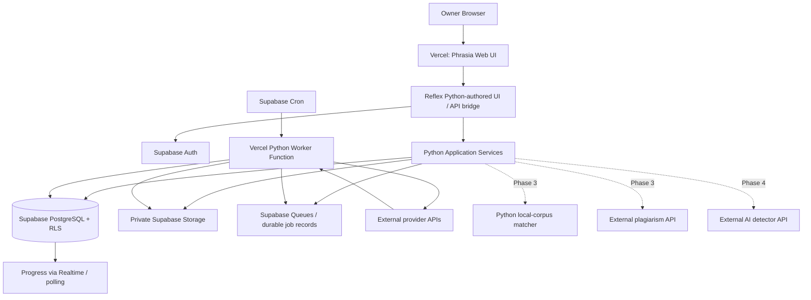
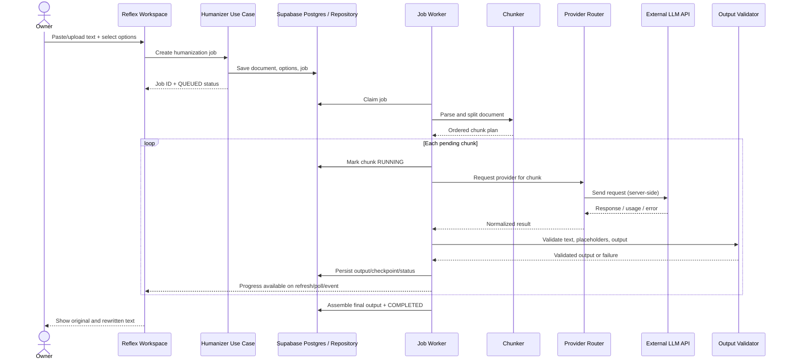
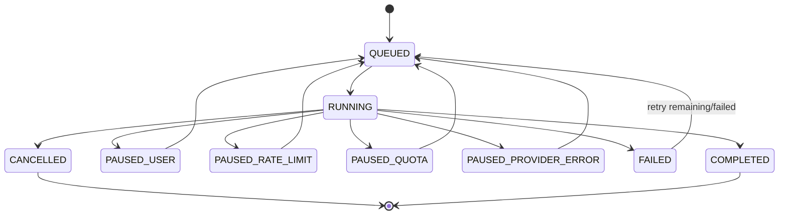

# Phrasia — Software Architecture & Agent Implementation Guide

## Python-first, Supabase-backed, Vercel-deployed, Humanizer-first

**Document type:** Software Architecture / Technical Design  
**Version:** 2.0  
**Status:** Draft for agent implementation  
**Prepared:** 19 November 2026  
**Companion document:** `Phrasia_PRD.md` and `Phrasia_OpenCode_Master_Build_Prompt.md`

---

## 0. Mandatory instructions for the coding agent

Read `Phrasia_PRD.md` completely before implementation. This document is the authoritative technical design; the Master Build Prompt authorizes sequential implementation.

### Non-negotiable constraints

- Product name: **Phrasia**. Proposed tagline: **Words, Refined.** (provisional) Product descriptor: **An intelligent workspace for better writing.**
- Primary development language: **Python**.
- Python-authored UI framework: **Reflex**. Do not create a separately maintained Next.js/React/TypeScript application. Reflex-generated browser assets are expected.
- Hosting target: **Vercel Hobby Free** for personal/non-commercial use.
- Backend data platform: **Supabase Free** (Postgres, Auth, Storage, Queues/Cron/Realtime as needed).
- Database: Supabase-managed PostgreSQL from the beginning; do not use SQLite or a local file-backed database for production.
- Database schema changes: Supabase CLI SQL migrations, committed to Git.
- Authentication: Supabase Auth, private owner-only access; public sign-up disabled after owner account setup.
- Every owner data table and Storage bucket must enforce Row Level Security (RLS).
- Large files upload directly to private Supabase Storage with signed upload URLs; do not route large file bodies through Vercel Functions unnecessarily.
- Durable job queue/checkpoint state lives in Supabase, not in Vercel process memory or local disk.
- Use Supabase Cron to trigger short-lived worker ticks. Do not use Vercel Hobby Cron for minute-level scheduling (Hobby schedule is daily only).
- Vercel Functions are short-lived: design worker invocations to process one or a few chunks and checkpoint well before the current Hobby function duration limit.
- Reflex + Vercel compatibility is a mandatory Phase 0 proof of concept. Do not assume WebSocket/event integration works without a deployed test.
- No Next.js application, no standalone handwritten TypeScript frontend, and no Node.js backend.
- **No Local LLM under any circumstances.** Do not add Ollama, llama.cpp, local transformer generation, local generative models, or a local text-generation server.
- Humanizer is the first functional module; implement and test it before starting Plagiarism or AI Detection.
- Free APIs are preferred where available; paid APIs must be supported architecturally but disabled by default and require explicit per-job owner approval.
- Never represent local reference matching as Internet-wide plagiarism detection.
- Never impose an arbitrary small application-level word cap. Use chunking and durable resumable jobs while respecting provider, Storage, and hosting limits.
- If no eligible Humanizer API is available, pause/save the job. Do not replace AI humanization with Python synonym substitution.

### Reflex and Vercel implementation clarification

Reflex lets the owner write UI components, state, and event handlers in Python; it compiles the browser frontend to React assets and runs Python backend logic. Reflex supports static frontend export with a separately reachable backend. Vercel supports Python/FastAPI Functions, but a complete Reflex event/WebSocket backend on Vercel must be proven in a small deployment spike before full implementation. The agent must test the current Reflex ASGI entrypoint and Vercel routing/runtime rather than assume a deployment recipe exists. If a direct Reflex backend deployment fails, follow the fallback specified in Section 14: retain Python-authored Reflex UI, serve it as static assets on Vercel, and expose a Python FastAPI API through Vercel Functions with only the small client bridge needed for API calls. Do not silently replace Reflex with Next.js.

## 1. Architecture summary

### 1.1 Recommended architecture

Phrasia is a private, single-owner Python-first web application. Reflex provides the Python-authored UI. Vercel hosts the web frontend and Python serverless endpoints. Supabase provides managed Postgres, Auth, private object storage, durable queues, scheduled worker triggers, and optional realtime progress updates. External APIs perform AI rewriting, plagiarism scanning, and AI detection. Python is responsible for document parsing, chunk planning, provider routing, output validation, job orchestration, local reference matching, and reports.

### 1.2 High-level architecture



### 1.3 Runtime boundaries

**Browser/client:**
- Renders generated Reflex frontend assets.
- Holds only short-lived UI state and an authenticated session mechanism.
- Never receives Supabase secret/service keys, provider API keys, worker secrets, or encryption keys.
- Requests document uploads through signed URLs and API operations through authenticated backend routes.

**Vercel Python application/functions:**
- Validate the Supabase Auth identity on every protected request.
- Apply owner scoping and rely on RLS wherever the request uses the user JWT.
- Parse documents, create durable jobs/chunks, route provider calls, and update Supabase records.
- Never assume a process remains alive after a response. No durable in-memory queue.
- Worker invocations claim bounded work, persist each completed chunk, then exit before the Vercel execution deadline.

**Supabase:**
- Postgres is the durable source of truth for accounts, documents, jobs, chunks, provider settings metadata, usage, reports, and authorizations.
- Auth provides owner identity and session tokens.
- Storage holds uploaded originals, large text bodies, output artefacts, exports, and reference files in private buckets.
- Queues/pgmq or a Postgres-backed claim queue persists worker messages.
- Cron triggers worker ticks; Realtime or polling provides UI updates.

**External providers:**
- Receive only the text necessary for the requested feature.
- Have independent data-retention, training/data-use, rate, pricing, and billing terms.
- Are never described as private/local execution.

### 1.4 Deployment principle

Treat the app as a cloud-hosted personal workspace with limited free-tier resources—not an unlimited compute service. Large documents should be streamed/uploaded to Supabase Storage, chunked on the server, and processed across multiple bounded worker invocations. The job must be resumable after Vercel Function termination, deployment, browser close, or temporary provider outage.

## 2. Technology decisions

| Layer | Selection | Notes |
|---|---|---|
| Primary language | Python | Main application and integrations. |
| Python-authored UI | Reflex | UI components, pages, and state written in Python; browser assets are generated. |
| Hosting | Vercel Hobby Free | Static frontend and Python Function/API hosting, subject to a Reflex deployment proof gate and personal/non-commercial terms. |
| Database | Supabase PostgreSQL | Production database from the first migration. |
| Auth | Supabase Auth | Single-owner login; public sign-up disabled after setup. |
| File storage | Supabase Storage | Private buckets, owner-scoped object paths, signed upload/download URLs. |
| Durable jobs | Supabase Queues (pgmq) or Postgres claim queue | Persistent messages/checkpoints; no Vercel memory-only worker queue. |
| Job scheduler | Supabase Cron | Calls a secured Vercel worker tick endpoint; not Vercel Hobby Cron. |
| Realtime progress | Supabase Realtime or polling | Prefer Realtime if stable; polling is an acceptable first release. |
| Supabase client | `supabase` Python package | Auth, PostgREST, Storage, RPC; server-side only where appropriate. |
| Database migrations | Supabase CLI SQL migrations | Versioned SQL migrations committed to repository. |
| HTTP | HTTPX | Async external provider calls. |
| Validation | Pydantic | Typed request, response, and provider schemas. |
| Document parsing | `python-docx`, `PyMuPDF` later | Parse text and preserve supported structure. |
| Local matching (Phase 3) | Python, Postgres full-text search, trigram/n-gram techniques | Only against the user's indexed corpus. No Local LLM. |
| Tests | pytest | Unit, integration, RLS, provider-contract tests. |
| Browser tests | Playwright | Authenticated UI/deployment smoke tests. |
| Dependency management | `uv` preferred | Lock exact dependencies. |
| Local development | Reflex CLI + Supabase local or cloud dev project | Local dev is a development workflow; production data remains in Supabase. |

### 2.1 Python version and package pinning

Use a Python version supported by the current Reflex release and Vercel Python runtime. Verify both before pinning. Prefer Python 3.12 if compatible with all selected dependencies. Pin dependencies in `pyproject.toml` and a lock file. Avoid unpinned latest dependencies.

### 2.2 Supabase data access strategy

- Use the official Supabase Python SDK for Auth, Storage, PostgREST, and RPC where possible.
- Keep a repository layer around all Supabase calls; do not scatter raw client calls across Reflex state handlers.
- Use a user-scoped Supabase client/JWT for owner-facing CRUD so RLS applies.
- Use the server-side secret key only in trusted backend/worker paths that require elevated access; validate the job owner and object path explicitly before every privileged operation.
- Never put a Supabase secret/service-role key in Reflex client state or generated assets.
- Use Supabase CLI migrations in `supabase/migrations/`; do not use Alembic.

### 2.3 Reflex deployment feasibility gate

Before complex application implementation, create a tiny Reflex proof app and deploy it to Vercel. Verify: static asset delivery, Python backend route, Reflex event connection (including WebSocket if required by the current Reflex version), auth/session callback behavior, and reconnect after a Function restart. Current Reflex documentation supports static frontend export with a separate `api_url`; current Vercel docs support Python/FastAPI Functions, but the exact combined Reflex deployment is not guaranteed by either vendor.

If the combined ASGI/WebSocket Reflex server works within Vercel constraints, keep it. If it does not, fallback to:
1. Reflex-generated static frontend deployed to Vercel;
2. Python FastAPI serverless API routes on Vercel;
3. a narrowly scoped Reflex custom component/client bridge for the API routes only;
4. Supabase for Auth, data, storage, and background queue.

Do not silently change the framework or hide the failed proof. Record the selected path in `DECISIONS.md`.

## 3. Application layers and responsibilities

### 3.1 Presentation layer — `app/`

Responsibilities:

- Page composition and navigation.
- Form controls and editor panels.
- Displaying job state, progress, warnings, and output.
- Sending user intent to state handlers.
- Rendering only safe, display-ready models.

Must not:

- Call external APIs directly.
- Contain provider credentials.
- Contain prompt templates or complex document algorithms.
- Calculate authoritative provider prices/quotas in the UI.
- Perform long-running network operations inside normal UI rendering.

### 3.2 Reflex state layer — `app/state/`

Responsibilities:

- Validate UI actions and basic input requirements.
- Call application services/use cases.
- Expose job/document status to the UI.
- Trigger background processing in a way that leaves the interface responsive.

Keep state classes thin. They should not own provider routing, chunking logic, SQL queries, or prompt construction.

### 3.3 Application/use-case layer — `core/` or `backend/services/`

Responsibilities:

- `CreateHumanizationJob`.
- `PauseHumanizationJob`.
- `ResumeHumanizationJob`.
- `CancelHumanizationJob`.
- `RetryFailedChunk`.
- `GetDocumentHistory`.
- Later: `RunPlagiarismCheck`, `RunAIDetection`.

Use cases orchestrate domain services and repositories. They should not depend on Reflex UI components.

### 3.4 Domain layer — `domain/`

Responsibilities:

- Core entities and enums.
- Job and chunk state transitions.
- Provider capability contracts.
- Validation rules.
- Output integrity checks.

Keep the domain layer free of Reflex imports and vendor SDK imports.

### 3.5 Infrastructure layer — `infrastructure/`

Responsibilities:

- HTTP clients and provider adapters.
- Supabase Postgres repositories, RLS policies, and Supabase CLI SQL migrations.
- File storage and document parsers.
- Configuration and secret loading.
- Logging and metrics.

---

## 4. Provider abstraction and routing architecture

This is one of the most important architectural requirements. The app must support free and paid APIs without changing Humanizer business logic.

### 4.1 Provider categories

| Task | Initial candidate | Later candidates |
|---|---|---|
| Text generation / Humanizer | Gemini API | Groq, OpenAI API, Anthropic API |
| AI detection | Not required in Phase 1 | Sapling, GPTZero, Copyleaks |
| Plagiarism scan | Not required in Phase 1 | Quetext, Copyleaks, Originality.ai |

Candidates are not commitments to a permanent free tier. The owner must verify account-level access, model availability, current pricing, and provider data terms before activation.

### 4.2 Suggested provider package structure

```text
providers/
├── base.py
├── registry.py
├── routing.py
├── errors.py
├── generation/
│   ├── base.py
│   ├── gemini.py
│   ├── groq.py          # Phase 2
│   ├── openai.py        # Phase 2 paid-capable
│   └── anthropic.py     # Phase 2 paid-capable
├── detection/
│   ├── base.py
│   ├── sapling.py       # Phase 4
│   ├── gptzero.py       # Later
│   └── copyleaks.py     # Later
└── plagiarism/
    ├── base.py
    ├── quetext.py       # Phase 3
    ├── copyleaks.py     # Phase 3/4
    └── originality.py  # Later
```

### 4.3 Text-generation provider contract

Create a vendor-neutral Python protocol/interface. Example conceptual contract:

```python
from typing import Protocol

class TextGenerationProvider(Protocol):
    provider_id: str

    async def generate(self, request: "GenerationRequest") -> "GenerationResult":
        ...

    async def health_check(self) -> "ProviderHealth":
        ...
```

`GenerationRequest` should contain:

- system/developer instructions;
- user/document instructions;
- chunk text;
- optional context carried from nearby chunks;
- model identifier;
- max output tokens;
- temperature or supported generation settings;
- timeout;
- job ID and chunk ID for traceability;
- request metadata that does not contain secrets.

`GenerationResult` should normalize:

- output text;
- provider ID;
- model ID;
- provider request ID if returned;
- input/output token usage if returned;
- estimated cost if calculable;
- finish reason / truncation information;
- warnings;
- raw response stored only when needed for safe debugging, with sensitive content excluded from normal logs.

A provider adapter is responsible for mapping this contract to the vendor's request/response API.

### 4.4 Provider configuration model

Each configured provider should have:

- provider ID;
- display name;
- task type (`generation`, `detection`, `plagiarism`);
- enabled/disabled flag;
- tier label (`free`, `trial`, `paid`, `unknown`);
- default model identifier;
- backend secret reference (environment variable name or secret-store key);
- priority;
- max request size/context configuration;
- optional rate-limit configuration;
- optional pricing/rate-card configuration;
- last health status and last error time.

Do not put API key values inside a Reflex state object or browser-accessible configuration response.

### 4.5 Routing policies

Implement these modes:

**FREE_ONLY**

- Only providers explicitly configured as free/trial and enabled by the owner are eligible.
- If all free providers fail or are exhausted, pause the job.
- Never call paid providers.

**HYBRID**

- Try configured free/trial providers in priority order.
- Paid providers are eligible only after explicit authorization for the current job, or a deliberately configured paid policy with a non-zero cap.
- Initial configuration still has paid disabled and USD 0 budget.

**MANUAL**

- The owner selects the provider for a job.
- The router still validates provider task compatibility, credentials, model, limits, and paid authorization.

Initial default is `FREE_ONLY`.

### 4.6 Paid-provider safety gate

The paid safety gate must be checked in backend code immediately before every paid request. Do not rely on hiding a UI button.

A paid call is allowed only when all conditions are true:

1. Provider is enabled.
2. Paid mode is enabled.
3. The current job has an explicit authorization record or valid owner policy.
4. The job's expected spend is within the configured cap.
5. Monthly spend remaining is greater than zero.
6. A valid key is configured.
7. The call's task/model is permitted.

Default values:

```text
paid_enabled = false
paid_monthly_budget_usd = 0
paid_auto_fallback = false
require_per_job_confirmation = true
```

No `429`, timeout, quota error, or lack of free providers may bypass this gate.

### 4.7 Provider error taxonomy

Normalize provider exceptions into a common set:

- `AUTHENTICATION_ERROR`
- `PERMISSION_ERROR`
- `RATE_LIMITED`
- `QUOTA_EXHAUSTED`
- `BILLING_REQUIRED`
- `INVALID_REQUEST`
- `MODEL_UNAVAILABLE`
- `CONTENT_POLICY_BLOCK`
- `TIMEOUT`
- `TRANSIENT_PROVIDER_ERROR`
- `OUTPUT_TRUNCATED`
- `UNKNOWN_PROVIDER_ERROR`

Routing rules:

- Rate limit/quota: use eligible alternative provider or pause with retry/reset information.
- Auth/permission: mark the provider configuration as needing attention; do not repeatedly retry.
- Invalid request/model: surface the error; do not repeat unchanged calls.
- Transient provider/network error: bounded retry with exponential backoff, then eligible fallback or pause.
- Content policy block: do not attempt to bypass the provider's controls; explain the provider response.
- Truncated output: mark chunk incomplete and retry with a smaller chunk or adjusted output budget where safe.

Do not use fallback for every error indiscriminately.

---

## 5. Humanizer pipeline architecture (Phase 1)

### 5.1 End-to-end sequence



### 5.2 Job creation

On a user clicking **Humanize Text**:

1. Validate that text is not empty.
2. Validate options and selected provider mode.
3. Create or reference a document record.
4. Store the original content as an immutable document version.
5. Create a humanization job record with mode, custom instructions, preservation toggles, language policy, and provider policy snapshot.
6. Create chunk records after the parser/chunker runs.
7. Return the job ID and initial status promptly; do not wait for the full generation request in the UI event.

### 5.3 Prompt construction

Prompt templates must be stored separately from UI components. Use versioned templates.

Prompt requirements:

- State that the task is rewriting for clarity, readability, tone, and natural flow.
- Preserve the source's meaning and factual claims.
- Preserve names, dates, amounts, identifiers, citations, quotations, URLs, and defined technical terms.
- Preserve the requested structure.
- Do not add citations, links, statistics, or facts.
- Do not summarize or expand unless the selected mode requires it.
- Return only the rewritten content in a predictable format; avoid commentary around the output.
- Keep the input language by default unless the owner explicitly chooses another language.

Do not instruct the model to evade, fool, or guarantee a pass from AI detectors. The feature should be framed as writing improvement, not detector circumvention.

### 5.4 Protected spans and document structure

Where practical, extract and protect:

- URLs;
- email addresses;
- code blocks;
- inline code;
- citation/reference tokens where pattern recognition is reliable;
- explicit quotations if preservation is enabled;
- special identifiers and numeric tokens.

A placeholder strategy may be used for high-risk spans. Placeholders must be unique per job/chunk and restored after generation. If a required placeholder is missing or changed, the chunk must fail validation or be repaired deterministically; do not silently drop the protected data.

Do not attempt to fully parse every possible citation format in Phase 1. Preserve text conservatively and disclose limitations.

### 5.5 Chunking algorithm

The chunker must be provider-aware and configurable.

**Inputs:**

- document text/structure;
- provider/model context limit (configured from current documentation or owner settings);
- prompt overhead estimate;
- expected output-token reserve;
- safety margin;
- maximum allowed request size;
- optional overlap/context policy.

**Process:**

1. Normalize line endings without altering text meaning.
2. Split by major document structure (headings/sections) when available.
3. Split sections into paragraphs.
4. Split a paragraph only when it exceeds the safe budget; prefer sentence boundaries.
5. Never split inside a protected span.
6. Build chunks under the safe input budget after reserving output tokens and prompt overhead.
7. Keep stable chunk order and boundary metadata.
8. Store source character offsets and an input hash for each chunk.

If the provider does not expose an exact tokenizer, use a conservative token estimator and a configurable safety margin. Do not assume a fixed word-to-token ratio is exact.

A chunk size is a provider/request implementation detail. It is not an application-level document limit.

### 5.6 Context continuity across chunks

To reduce inconsistent terminology and abrupt transitions:

- Pass the same document-level rewrite brief to all chunks.
- Include document title and section heading when available.
- Include a small configurable previous-chunk tail or a generated context note only if useful and within budget.
- Maintain a document glossary of terms that must remain unchanged when possible.
- Avoid sending the entire previously rewritten document repeatedly.

Start with a simple stable strategy. Do not spend additional API quota on elaborate multi-pass summarization until tests show it is necessary.

### 5.7 Output validation

For each chunk:

- Ensure response is non-empty.
- Check finish reason and token-limit/truncation indicators when available.
- Check protected placeholders.
- Check that output is not merely an API error or refusal wrapper.
- Check suspicious length collapse/expansion against configurable thresholds; warn or retry rather than auto-rejecting every concise output.
- Store provider/model/request ID/usage metadata.

At document assembly:

- Sort by chunk sequence.
- Confirm every required chunk has a valid output.
- Confirm no chunk is missing or duplicated.
- Restore protected spans.
- Preserve separators and paragraph order.
- Store final output as a new immutable document version.

Never mark a partially processed document as `COMPLETED`.

### 5.8 Durable queue and checkpoint model (Supabase + Vercel)

A Vercel Function is not a long-running process. Do not start a permanent Python worker loop inside Vercel and do not rely on in-memory background tasks for durable work.

Use Supabase Queues (`pgmq`) or a Postgres-backed queue table as the durable source of work. Use Supabase Cron to invoke a secured Vercel Python worker endpoint at a frequent interval (for example, every minute) if supported by the current Supabase plan/configuration. Do not use Vercel Hobby Cron for frequent processing: the Hobby schedule is currently limited to once per day.

**Worker tick contract:**
1. Verify a dedicated `WORKER_CRON_SECRET` using constant-time comparison. Reject unauthenticated calls.
2. Claim one job/chunk (or a very small bounded batch) atomically using queue visibility/lease semantics or `FOR UPDATE SKIP LOCKED` inside a database function.
3. Read the source chunk from a private Supabase Storage object or secured database record.
4. Check job status, owner authorization, provider eligibility, quota/rate-limit cooldowns, and paid-provider authorization.
5. Process the chunk using the provider adapter with a hard internal deadline below the Vercel Function maximum. Aim to stop by 240 seconds and reserve time to persist results/cleanup.
6. Persist the completed output, provider metadata, usage, and checkpoint in Supabase before returning.
7. Acknowledge the queue message only after durable persistence succeeds.
8. If transient failure occurs, update retry count/next eligible time and release/requeue the message. Do not mark a job complete prematurely.
9. Exit. A future Cron tick continues remaining chunks.

**Important:** Supabase Cron can invoke HTTP endpoints and Supabase Queues provides durable messages. The current Supabase Cron guidance recommends keeping individual jobs under 10 minutes; the Vercel Hobby Function hard maximum is currently 300 seconds, so the Vercel limit is stricter. Treat all these values as changeable plan limits and re-check them before deployment.

**Progress UI:** Prefer Supabase Realtime for job status changes. If that creates complexity or quota concerns, use short-interval polling with backoff. UI progress is derived from persisted chunk state, not from process memory.

**Idempotency:** assign stable IDs to jobs and chunks. Before retrying a provider call after an ambiguous timeout, inspect persisted state and the provider's idempotency support to avoid duplicate paid usage. Persist each successful chunk immediately.

The design must recover jobs after browser close, Vercel cold start, Vercel deployment, and Supabase connection interruption.

### 5.9 Job state machine



A resume operation should requeue only the incomplete chunks unless the owner explicitly requests a full rerun.

---

## 6. Plagiarism architecture (Phase 3)

### 6.1 Separate local matching from external plagiarism scanning

These are distinct services and must remain distinct in code and UI.

**Local reference matcher:**

- Searches only documents deliberately imported/indexed by the owner.
- Uses Python-based exact phrase/hash matching, n-gram overlap, and optionally TF-IDF.
- May use PostgreSQL full-text search (`tsvector`) and trigram matching for text retrieval.
- Can provide matched passages and a clearly defined local corpus coverage metric.
- Does not need a Local LLM.

**External plagiarism provider:**

- Calls a specialist provider API.
- Provider supplies its own report, matching sources, and similarity score.
- Adapter maps provider response to a normalized report without changing the score's meaning.

### 6.2 Local matching metrics

Avoid calling every similarity metric “plagiarism percentage.” For local search, use precise labels such as:

- `matched_word_coverage_percent` — share of eligible input words that belong to matched passages under the chosen matching rule;
- `source_document_similarity` — a lexical similarity metric for a given source document;
- `matched_passage_count` — number of passages meeting the threshold.

The UI must explain that this represents similarity against the indexed local reference library, not the Internet.

### 6.3 Source corpus rules

- Index only user-provided documents or content the owner is authorized to store and compare.
- Store source origin, title, file hash, imported date, and optional URL/license metadata.
- Do not scrape the web or bulk-download copyrighted sources without authorization/lawful basis.
- Provide source removal and re-indexing controls.

---

## 7. AI detector architecture (Phase 4)

- Detection is API-first and external-provider-based.
- Create a `TextDetectionProvider` protocol separate from Humanizer generation.
- Store raw provider score, provider verdict, model/version, language, confidence flags, sentence results, offsets, and request metadata.
- Normalize only presentation fields, preserving raw provider response values in a safe structured form.
- The provider's documentation defines what its score represents. Do not assume all scores are comparable across providers.
- Do not average providers' AI scores into an invented “truth score.” If multiple providers are later compared, show each independently.
- Show low-confidence, short-text, and unsupported-language warnings.
- AI detection is probabilistic and can generate false positives/false negatives. It is not proof of authorship.

Sapling is a candidate adapter because its current API documentation describes document-level and sentence-level scores, input limits, language coverage, and caveats. Its currently documented language list does not include Bengali; requests in unsupported languages may be scored by a less appropriate model and must be warned about. Recheck its current documentation at implementation time: [Sapling AI Detector API](https://sapling.ai/docs/api/detector/).

---

## 8. Data model and persistence

Use the Supabase Python client and Supabase CLI SQL migrations. The following is a conceptual model; the coding agent may refine columns and relationships but must preserve the capabilities.

### 8.1 Core tables

#### `documents`

- `id` (UUID/string primary key)
- `title`
- `original_filename` (nullable)
- `source_type` (`pasted_text`, `txt_upload`, `docx_upload`, later `pdf_upload`)
- `language_hint` (nullable)
- `created_at`
- `updated_at`
- `is_deleted` or soft-delete metadata if needed

#### `document_versions`

- `id`
- `document_id`
- `version_number`
- `version_type` (`original`, `humanized`, later `manual_edit`, `imported`)
- `content_text` or controlled file reference
- `content_hash`
- `word_count`
- `character_count`
- `created_at`
- `parent_version_id` (nullable)

Original content must be immutable after creation.

#### `humanization_jobs`

- `id`
- `document_id`
- `source_version_id`
- `result_version_id` (nullable until complete)
- `status`
- `mode`
- `intensity`
- `custom_instruction` (nullable)
- `preserve_meaning`
- `preserve_facts`
- `preserve_citations`
- `preserve_formatting`
- `provider_mode`
- `selected_provider_id` (nullable)
- `paid_authorization_id` (nullable)
- `total_chunks`
- `completed_chunks`
- `created_at`, `started_at`, `updated_at`, `completed_at`
- `last_error_code` (nullable)
- `last_error_message_safe` (nullable)

#### `humanization_chunks`

- `id`
- `job_id`
- `sequence_index`
- `source_start_offset`
- `source_end_offset`
- `source_text` or secure source reference
- `source_hash`
- `status`
- `provider_id` (nullable)
- `model_id` (nullable)
- `attempt_count`
- `output_text` (nullable)
- `input_tokens` (nullable)
- `output_tokens` (nullable)
- `estimated_cost_usd` (nullable)
- `provider_request_id` (nullable)
- `last_error_code` (nullable)
- `created_at`, `updated_at`, `completed_at`

#### `provider_configs`

- `id`
- `provider_id`
- `task_type`
- `display_name`
- `tier_label`
- `enabled`
- `priority`
- `default_model`
- `secret_reference` (never raw key)
- `configuration_json` (non-secret settings only)
- `last_health_status`
- `updated_at`

#### `provider_usage`

- `id`
- `provider_id`
- `task_type`
- `job_id` (nullable)
- `chunk_id` (nullable)
- `model_id`
- `input_tokens` / `output_tokens` or character/word usage (nullable)
- `estimated_cost_usd` (nullable)
- `actual_cost_usd` (nullable only if authoritative data exists)
- `status_code` / normalized outcome
- `created_at`

#### `paid_authorizations` (Phase 2)

- `id`
- `job_id`
- `provider_id`
- `approved_by_owner`
- `approved_at`
- `estimated_cost_usd`
- `max_cost_usd`
- `authorization_status`

#### Future: `plagiarism_reports`, `local_reference_sources`, `local_match_results`, `ai_detection_reports`

Add these tables only when the corresponding phase begins.

### 8.2 Database choice

Use Supabase-managed PostgreSQL from the start. Do not use SQLite or a local file-backed database as the production database. Use Supabase CLI SQL migrations committed under `supabase/migrations/`. The Postgres database is the durable source of truth for metadata, job state, checkpoints, provider usage, and reports.

Use RLS on every owner-owned table. Recommended default policy pattern: authenticated user can select/insert/update/delete only rows where `owner_id = auth.uid()`. Verify this through automated integration tests, not only manual inspection.

For privileged worker operations, use a server-side secret key only from Vercel environment variables. The worker must still verify the job's owner and task authorization before processing. Never trust a client-supplied `owner_id` or Storage path.

### 8.3 File storage

Use private Supabase Storage buckets, not local persistent folders:

- `phrasia-documents` — original uploads and normalized source text;
- `phrasia-outputs` — humanized outputs and version artefacts;
- `phrasia-exports` — downloadable TXT/DOCX/PDF reports;
- `phrasia-reference-library` — user-imported documents for the later local-corpus matcher.

Use owner-scoped paths such as `{owner_id}/{document_id}/{version_id}/source.txt`. Generate IDs server-side. Use signed upload/download URLs with short expiry. Do not mark buckets public. Delete the Storage object and related Postgres rows when a document is deleted.

Large uploads should go directly from browser to Supabase Storage using signed upload URLs. Avoid routing the file bytes through Vercel Functions. Keep only small metadata and object references in Postgres. Supabase Free currently lists 1 GB storage and 50 MB maximum object upload size; this is a platform limit, not an application word-count cap.

## 9. Proposed repository structure

Keep modules small and responsibility-based. Suggested structure (adjust only when actual deployment proof requires it):

```text
phrasia/
├── app/
│   ├── app.py
│   ├── pages/
│   │   ├── workspace.py
│   │   ├── history.py
│   │   ├── settings.py
│   │   ├── plagiarism.py          # Phase 3
│   │   └── ai_detector.py         # Phase 4
│   ├── components/
│   │   ├── app_shell.py
│   │   ├── input_editor.py
│   │   ├── output_panel.py
│   │   ├── humanizer_controls.py
│   │   ├── progress_panel.py
│   │   └── custom/                # minimal bridge only if Reflex/Vercel proof needs it
│   └── state/
│       ├── workspace_state.py
│       ├── job_state.py
│       └── settings_state.py
│
├── core/
│   ├── domain/
│   ├── use_cases/
│   └── services/
│       ├── humanizer_service.py
│       ├── prompt_builder.py
│       ├── chunking_service.py
│       ├── output_validator.py
│       └── document_assembler.py
│
├── providers/
│   ├── base.py
│   ├── registry.py
│   ├── router.py
│   ├── errors.py
│   └── generation/
│       ├── base.py
│       ├── gemini.py
│       ├── groq.py
│       ├── openai.py
│       └── anthropic.py
│
├── infrastructure/
│   ├── config/
│   ├── supabase/
│   │   ├── client.py
│   │   ├── auth.py
│   │   ├── repositories/
│   │   ├── storage.py
│   │   └── queue.py
│   ├── documents/
│   │   ├── parser.py
│   │   ├── txt_parser.py
│   │   ├── docx_parser.py
│   │   └── pdf_parser.py
│   ├── jobs/
│   │   ├── worker_tick.py
│   │   ├── claim.py
│   │   └── recovery.py
│   └── logging/
│
├── api/                            # Vercel Python Function entrypoints / FastAPI bridge if required
│   ├── index.py
│   └── worker_tick.py
├── prompts/humanizer/
├── supabase/
│   ├── config.toml
│   └── migrations/
├── tests/
│   ├── unit/
│   ├── integration/
│   ├── rls/
│   ├── provider_contracts/
│   └── ui/
├── public/                         # Reflex static export when using split deployment
├── .env.example
├── .gitignore
├── pyproject.toml
├── rxconfig.py
├── vercel.json
├── README.md
├── PROJECT_PROGRESS.md
├── AGENT_HANDOFF.md
├── IMPLEMENTATION_LOG.md
└── DECISIONS.md
```

Do not create empty folders for every future provider/module just to make the tree look complete. Add code as the corresponding phase begins. Vercel entrypoint structure must be validated with a deployed proof of concept and the current Vercel Python runtime documentation.

## 10. Configuration and secrets

### 10.1 Environment configuration

Use Vercel Project Environment Variables for production and a local `.env` for development. Example placeholders only:

```dotenv
APP_ENV=development
APP_BASE_URL=http://localhost:3000
REFLEX_API_URL=
REFLEX_DEPLOY_URL=

SUPABASE_URL=
SUPABASE_PUBLISHABLE_KEY=
SUPABASE_SECRET_KEY=
SUPABASE_DB_URL=
SUPABASE_STORAGE_DOCUMENTS_BUCKET=phrasia-documents
SUPABASE_STORAGE_OUTPUTS_BUCKET=phrasia-outputs
SUPABASE_STORAGE_EXPORTS_BUCKET=phrasia-exports
SUPABASE_STORAGE_REFERENCES_BUCKET=phrasia-reference-library

WORKER_CRON_SECRET=
PHRASIA_SECRET_ENCRYPTION_KEY=

HUMANIZER_DEFAULT_MODE=free_only
HUMANIZER_PRIMARY_PROVIDER=gemini
GEMINI_API_KEY=
GEMINI_MODEL=
GROQ_API_KEY=
GROQ_MODEL=
OPENAI_API_KEY=
OPENAI_MODEL=
ANTHROPIC_API_KEY=
ANTHROPIC_MODEL=

PAID_PROVIDERS_ENABLED=false
PAID_MONTHLY_BUDGET_USD=0
PAID_AUTO_FALLBACK=false
REQUIRE_PER_JOB_PAID_APPROVAL=true
```

Only add the Supabase DB connection URL if the selected worker/queue implementation actually requires direct Postgres access. Prefer Supabase RPC/Queues APIs where feasible. Do not hardcode provider model names, quotas, or prices; verify them at implementation time.

### 10.2 API key handling

- Read secrets only in backend code and Vercel environment variables, or store encrypted values using `PHRASIA_SECRET_ENCRYPTION_KEY` if the owner needs a provider-settings UI.
- Redact secrets from exceptions and logs.
- Never store keys in Reflex state or frontend component props.
- Never expose `.env` values through a settings endpoint.
- `.env` must be in `.gitignore`.
- A future settings UI must either keep keys in environment variables or encrypt them at rest using a master key stored outside the database. Do not store plaintext API keys in `provider_configs`.

### 10.3 Provider privacy notice

Before the first text submission to a provider, show a concise notice that the document text is sent to that external provider. Include a link to the provider's current privacy/data-use terms.

This is especially important for free tiers. For example, Gemini's official pricing page currently distinguishes free and paid tiers and describes different data-use treatment. The app must not imply that free-tier text receives the same data handling as paid-tier text. The owner should be able to choose a provider based on the text's sensitivity and the account's configured tier.

---

## 11. API usage, quota, and cost management

### 11.1 Usage measurement

For each API request, record when available:

- provider and model;
- input/output tokens or characters/words;
- request ID;
- request timestamp;
- status/outcome;
- rate-limit headers;
- provider-reported usage;
- estimated cost using the currently configured rate card.

Do not claim exact costs if the provider does not return authoritative billing data. Mark locally calculated values as estimates.

### 11.2 Rate-limit handling

- Respect `Retry-After` and provider-specific reset headers when available.
- Maintain a local rolling usage estimate where appropriate.
- Do not assume a free-tier quota from a marketing page is the same as the owner's account limit.
- Treat provider response headers and account console limits as more authoritative than hardcoded defaults.
- Use bounded exponential backoff for transient failures.

### 11.3 Cost protection

Initial defaults:

```text
FREE_ONLY = true
PAID_PROVIDERS_ENABLED = false
PAID_AUTO_FALLBACK = false
PAID_MONTHLY_BUDGET_USD = 0
REQUIRE_PER_JOB_PAID_APPROVAL = true
```

Before a paid job:

- show selected provider/model;
- show current configured pricing source/date;
- estimate job cost if input/output estimates are available;
- ask for confirmation;
- enforce per-job and monthly caps server-side.

If cost cannot be estimated reliably, say so and require explicit confirmation. Never infer that a provider is free because its web UI has a free plan.

---

## 12. Security and privacy architecture

### 12.1 Hosted private application

Phrasia is deployed at a Vercel URL, so localhost-only assumptions are invalid. Require Supabase Auth for all non-public routes and data operations. Disable public registration after the owner's account exists. Use HTTPS, secure session handling, strict allowed origins, and owner-only route protection. The application must fail closed when Supabase Auth cannot validate the session.

Use RLS on all owner-owned Postgres tables and private Storage buckets. Every query and worker action must be owner-scoped. Do not trust IDs or object paths supplied by the browser. Never return Supabase secret keys or provider credentials to the frontend.

### 12.2 Upload security

- Validate filename extension and content signature where possible.
- Use signed direct uploads to private Supabase Storage buckets.
- Enforce the configured maximum upload size; Supabase Free currently lists 50 MB per object. This is an infrastructure limit, not a word-count product cap.
- Generate server-side object names and owner-scoped paths.
- Prevent path traversal and insecure object-path substitution.
- Reject corrupt, encrypted, empty, or unsupported files with clear errors.
- Avoid extracting macros or executing embedded content.
- Do not process uploaded files with shell commands.
- Do not stream large uploads through a Vercel Function unless necessary and within platform limits.

### 12.3 Logging

Log metadata, not document text. For normal logs record job IDs, provider IDs, status, latency, and error codes. Do not log full prompts, original content, outputs, API keys, authorization headers, or raw private provider responses.

For debugging, use an explicit temporary debug option that warns the owner and redacts secrets; default off.

### 12.4 Data deletion

Provide delete controls for Supabase-backed documents, outputs, job records, and uploads. Explain that deletion from the local app does not automatically delete text already submitted to an external provider; provider deletion support must be separately integrated if available.

---

## 13. UI architecture and component guidance

### 13.1 Initial pages

- `/` or `/workspace` — Humanizer workspace.
- `/history` — documents and rewrite jobs.
- `/settings` — provider setup/status and defaults.

Add Plagiarism and AI Detector pages only when their phases begin.

### 13.2 Workspace components

- `DocumentHeader`: title, status, word count, character count.
- `InputEditor`: paste/edit/upload input.
- `HumanizerOptions`: mode, intensity, preservation toggles, custom instruction.
- `HumanizeAction`: validates and creates the job.
- `JobProgressPanel`: progress, current chunk, provider, pause/resume/cancel.
- `OutputPanel`: rewritten text, copy/download/save version.
- `ComparisonView`: basic side-by-side comparison in Phase 1; advanced diff later.

### 13.3 UI state versus persisted state

Reflex state is for current interaction and rendering. The database is the source of truth for durable documents, jobs, chunks, and versions. Do not store a 50,000-word document repeatedly inside every UI state variable. Store IDs and bounded display fields in UI state; load content as needed.

### 13.4 Background tasks

Reflex background events can run long-running operations without blocking UI interactions, but they are not a durable queue. Use them only as a UI integration mechanism if appropriate. Durable job state and recovery must live in Supabase Postgres and the Python worker/orchestrator.

---

## 14. Supabase + Vercel deployment architecture

### 14.1 Supabase Free responsibilities

Use the Supabase project as the managed backend platform:
- Postgres database for all durable application state;
- Supabase Auth for owner sign-in;
- private Storage buckets for original documents, rewritten versions, exports, and reference documents;
- Queues/pgmq or a Postgres-backed queue for resumable processing;
- Cron to invoke a secured Vercel worker endpoint;
- Realtime or polling for job status updates.

Current Free-plan snapshot checked 19 November 2026: 500 MB database, 1 GB file storage, 5 GB egress plus 5 GB cached egress, 50 MB maximum object upload, and project pause after one week of inactivity. Re-check the live pricing page before deployment. Design the app to display quota warnings and permit cleanup/export. Supabase Free has no guaranteed always-on service; after inactivity the owner may need to resume the project.

### 14.2 Vercel Hobby responsibilities and constraints

Use Vercel Hobby for the private personal deployment:
- serve Reflex static frontend assets;
- host Python serverless API/worker routes if the deployment proof passes;
- connect Git for preview/production deploys.

Current Vercel Hobby snapshot checked 19 November 2026: Python Functions have a 300-second maximum duration and 2 GB / 1 vCPU. Hobby Cron is limited to once per day, so it cannot be used for minute-by-minute queue polling. Hobby terms limit the free plan to personal or non-commercial use. Re-check the current limits and terms. If Phrasia becomes a public/commercial service, review Vercel plan eligibility before launch.

### 14.3 Reflex-to-Vercel proof of concept (mandatory)

Reflex's hosting docs describe `api_url` for a backend at a separate address and `reflex export` for static frontend assets. Vercel documents Python/FastAPI Functions. Before implementing the full application, the agent must:

1. Create a minimal Reflex app with one page, one state variable, and one event handler.
2. Test normal local Reflex development.
3. Export the Reflex frontend with `REFLEX_API_URL` set to the intended Vercel backend URL.
4. Deploy the static frontend to Vercel.
5. Expose the Reflex ASGI backend through a Vercel Python Function only if the current Reflex release exposes a compatible ASGI callable and Vercel routes can support the required event/WebSocket paths.
6. Verify the deployed browser can connect, invoke the event, receive the updated state, and reconnect after a function restart/timeout.
7. Verify Supabase Auth callbacks and protected route behavior.
8. Record timings, caveats, logs, and the chosen deployment strategy in `DECISIONS.md`.

If that fails, use the fallback: Reflex-generated static frontend on Vercel plus a Python FastAPI backend/API on Vercel Functions; keep the UI authored in Reflex and isolate a minimal custom client bridge for API requests. The fallback must retain Python for all business logic and provider integration. Do not switch to Next.js without owner approval.

### 14.4 Durable background processing within Vercel limits

- Supabase Queues/Postgres is the source of truth for jobs and chunks.
- Supabase Cron calls `/api/worker/tick` (or the validated Vercel Python route) using a secret stored in Supabase Vault and Vercel environment variables.
- The worker validates `WORKER_CRON_SECRET`, claims a queue message atomically, processes one/few chunks, stores the output/checkpoint, acknowledges the message, and exits.
- Set an internal deadline around 240 seconds to leave room before the current 300-second Hobby Function maximum. Make this configurable and re-check the deployed plan limit.
- A worker must never depend on in-memory state surviving invocation termination.
- Use lease/visibility timeout and idempotent chunk IDs to avoid duplicate work. Retry only eligible transient failures and respect provider `Retry-After`.
- Supabase Cron documentation recommends keeping jobs under 10 minutes and limiting concurrent jobs; the stricter Vercel Function duration takes precedence for this architecture.
- Do not use Vercel Hobby Cron for minute-level polling.

### 14.5 Direct uploads and large documents

- Generate a signed upload URL from an authenticated backend route.
- Upload the file directly from browser to the private Supabase Storage bucket.
- Persist file metadata and Storage path in Postgres.
- Worker downloads/streams the source object and performs server-side parsing/chunk planning.
- Store normalized chunks and generated outputs in private Storage or Postgres according to size; do not put very large text blobs in Postgres rows unnecessarily.
- Do not call the whole app “unlimited”. It has no arbitrary small word-count cap, but Supabase file size/storage, Vercel request/runtime limits, and provider quotas are real constraints.

### 14.6 RLS, Auth, and service credentials

- Require Supabase Auth for every protected page and API endpoint.
- Disable public sign-up for the single-owner app after initial account creation.
- Set production and local redirect URLs.
- Apply RLS to every owner-scoped table and every private Storage bucket.
- The browser may use only the Supabase publishable key where direct client-side Supabase access is needed; never expose secret/service-role credentials.
- Server-side service credentials must be stored in Vercel environment variables and used only by trusted server code.
- Ensure worker jobs are associated with an owner and verify that owner, task, and paid authorization before provider calls.

### 14.7 Environment variables

At minimum document these placeholders in `.env.example` and Vercel settings:

```dotenv
APP_ENV=production
APP_BASE_URL=https://your-phrasia-project.vercel.app
REFLEX_API_URL=
REFLEX_DEPLOY_URL=
SUPABASE_URL=
SUPABASE_PUBLISHABLE_KEY=
SUPABASE_SECRET_KEY=
SUPABASE_DB_URL=
WORKER_CRON_SECRET=
PHRASIA_SECRET_ENCRYPTION_KEY=
GEMINI_API_KEY=
GROQ_API_KEY=
OPENAI_API_KEY=
ANTHROPIC_API_KEY=
PAID_PROVIDERS_ENABLED=false
PAID_MONTHLY_BUDGET_USD=0
PAID_AUTO_FALLBACK=false
REQUIRE_PER_JOB_PAID_APPROVAL=true
```

Do not set `SUPABASE_DB_URL` if the chosen implementation does not need direct Postgres. Never put real secrets in examples, source, documentation, or Git.

### 14.8 Official hosting references

- Supabase pricing: https://supabase.com/pricing
- Supabase Auth: https://supabase.com/docs/guides/auth
- Supabase Storage: https://supabase.com/docs/guides/storage
- Supabase Queues: https://supabase.com/docs/guides/queues
- Supabase Cron: https://supabase.com/docs/guides/cron
- Supabase Python client: https://supabase.com/docs/reference/python/introduction
- Vercel Python/FastAPI: https://vercel.com/kb/guide/ship-a-fastapi-app-on-vercel
- Vercel Function limits: https://vercel.com/docs/limits
- Vercel Cron limits: https://vercel.com/docs/cron-jobs/usage-and-pricing
- Vercel Hobby terms: https://vercel.com/legal/terms
- Reflex hosting/static export: https://reflex.dev/docs/hosting/self-hosting/

## 15. Development phases and architecture gates

The technical phases must follow the PRD sequence.

### Phase 0 — Phrasia foundation and deployment proof

Build:

- Phrasia Reflex app shell and centralized brand tokens;
- Supabase Postgres, Auth, private Storage, RLS, and Supabase CLI migrations;
- Vercel Hobby deployment proof for Reflex event/backend transport;
- private signed upload/download proof;
- durable Supabase queue + secured Vercel worker tick + Supabase Cron proof;
- safe logging, tests, and local-development/deployment instructions.

Gate: owner-only login works on Vercel, RLS and Storage tests pass, one Reflex event round-trip works in production, and a durable test job can be claimed, checkpointed, and resumed. If direct Reflex backend hosting fails, implement the documented Python FastAPI serverless fallback and record the choice.

### Phase 1 — Humanizer MVP

Build:

- provider interface and registry;
- Gemini adapter (or another owner-approved first provider if current account access dictates);
- Humanizer prompt templates and modes;
- document parser for text and basic TXT/DOCX support as scope permits;
- chunker and assembler;
- persistent job/chunk tables;
- sequential worker/orchestrator;
- pause/resume/cancel/retry;
- workspace and output view;
- history and TXT export;
- paid-provider guard always blocking by default.

Gate: real API rewrite works on a document requiring multiple chunks; output is correctly assembled; a quota failure does not lose completed chunks or trigger paid usage.

### Phase 2 — Provider and document robustness

Build:

- Groq adapter;
- OpenAI/Anthropic paid adapters;
- routing policy and manual selection;
- per-job paid authorization and cost limits;
- usage dashboard;
- secure provider configuration interface;
- improved DOCX and PDF parsing/export.

Gate: provider can be changed without modifying Humanizer business logic; paid safety tests pass.

### Phase 3 — Plagiarism

Build:

- local authorized reference-library index;
- local exact/n-gram/TF-IDF matching;
- external provider adapter;
- source/result UI and exports.

Gate: local and external result types are clearly distinguished.

### Phase 4 — AI Detector

Build:

- detector provider protocol;
- Sapling adapter candidate;
- later providers as selected;
- score/warning/sentence result UI.

Gate: uncertainty and language limitations are visible; raw scores are preserved.

### Phase 5 — Premium polish

Build only after all core modules pass their gates:

- richer editor and advanced diff;
- batch jobs;
- advanced PDF/DOCX fidelity;
- polished report exports;
- advanced history/search;
- Vercel/Supabase Free-tier deployment hardening and owner-only authentication.

---

## 16. Agent workflow and implementation rules

### 16.1 Before coding

The agent must:

- inspect the current repository;
- identify existing code and preserve it unless replacement is approved;
- verify current Reflex installation/version compatibility;
- verify current provider model IDs, API request format, limits, pricing, and privacy terms;
- produce a short phase plan;
- avoid adding packages for future modules that are not being implemented.

### 16.2 During coding

- Keep provider SDK/API calls in provider adapters.
- Keep prompt templates outside UI pages.
- Keep database calls behind repositories.
- Keep Reflex state classes thin.
- Use type hints and Pydantic schemas for external data.
- Add tests with each service.
- Do not hardcode API keys.
- Do not use paid services in tests.
- Do not create mock results that look like real scan results in production UI. Clearly mark development fixtures.
- Avoid premature abstraction beyond the provider interface and job/chunk processing boundaries.

### 16.3 At the end of each phase

Report:

1. What is complete.
2. What is not complete.
3. Commands to run the app.
4. Required environment variables and setup.
5. Test results.
6. Known limitations.
7. Whether the phase's acceptance gate has passed.
8. The next phase proposal (do not start it automatically).

---

## 17. Important implementation cautions

1. **Do not equate chunking with unlimited free use.** Chunking solves request-size constraints; it does not remove rate limits, quota, cost, or model quality limits.
2. **Do not auto-switch to paid APIs.** Enforce authorization in backend routing on every request.
3. **Do not add Local LLM.** There is no model running on the owner's computer.
4. **Do not fake local plagiarism scope.** Local Python matching is only as broad as the indexed corpus.
5. **Do not treat detector scores as proof.** Preserve provider uncertainty and false-positive warnings.
6. **Do not assume Bengali support.** Verify provider language support and quality before displaying a confident Bengali result.
7. **Do not send sensitive text without a provider notice.** Especially check data-use terms for free tiers.
8. **Do not run large API calls in normal UI event handlers.** Use job orchestration and background processing.
9. **Do not store only transient UI progress.** Persist every completed chunk.
10. **Do not implement all modules at once.** Humanizer MVP first.

---

## 18. Official technical references

Check these official documents again when implementing because API models, prices, quotas, and framework APIs can change.

### Reflex

- [Reflex documentation](https://reflex.dev/docs/)
- [How Reflex works](https://reflex.dev/docs/advanced-onboarding/how-reflex-works/)
- [Reflex background events](https://reflex.dev/docs/events/background-events/)
- [Wrapping React components](https://reflex.dev/docs/wrapping-react/overview/)
- [Reflex state overview](https://reflex.dev/docs/state/overview/)

### Generation providers

- [Gemini API documentation](https://ai.google.dev/gemini-api/docs)
- [Gemini API pricing](https://ai.google.dev/gemini-api/docs/pricing)
- [Gemini API rate limits](https://ai.google.dev/gemini-api/docs/rate-limits)
- [Groq API documentation](https://console.groq.com/docs)
- [Groq rate limits](https://console.groq.com/docs/rate-limits)
- [OpenAI API documentation](https://platform.openai.com/docs/)
- [OpenAI API pricing](https://openai.com/api/pricing/)
- [Anthropic API documentation](https://docs.anthropic.com/)
- [Anthropic API pricing](https://www.anthropic.com/pricing#anthropic-api)

### Plagiarism and AI detection providers (future phases)

- [Quetext API](https://www.quetext.com/developers-api)
- [Copyleaks API documentation](https://docs.copyleaks.com/)
- [Sapling AI Detector API](https://sapling.ai/docs/api/detector/)
- [GPTZero API](https://docs.gptzero.me/api-reference/)

### Reference notes checked on 19 November 2026

- Reflex documentation states that Python-defined UI is compiled to a React frontend, with Python backend/state handling; custom React components can be wrapped when needed.
- Reflex documentation describes background events as UI-friendly long-running event handlers, but explicitly distinguishes them from durable job queues. Persisted job/chunk records are therefore required for restart recovery.
- Gemini's published pricing page currently distinguishes free and paid tiers, with different data-use terms and rate-limit characteristics. Display the current privacy notice and let the owner choose a tier/provider appropriate to the text.
- Groq documents rate limits in RPM/RPD/TPM/TPD and returns rate-limit headers; read actual account/model limits rather than assuming a fixed universal free quota.
- Sapling currently documents document and sentence AI-likelihood scores, request limits, language support, and false-positive/false-negative caveats. Its listed supported languages should be checked against the intended content language before use.
- Quetext currently documents separate plagiarism and AI-detection endpoints, provider request caps, and prepaid wallet billing. Do not bake current prices/limits into application logic.

---

**End of Architecture Document**


## 19. Phrasia brand implementation notes

Use the name **Phrasia** consistently in page titles, app metadata, README, deployment project display name, and UI wordmark. Proposed tagline: **Words, Refined.** (provisional) Descriptor: **An intelligent workspace for better writing.**

Visual tokens (centralized, never scatter hex codes in components):
- `brand.primary = #174D3B` (deep evergreen)
- `brand.accent = #CFE8DC` (soft mint)
- `surface.base = #F7F7F2` (warm off-white)
- `text.primary = #18221F` (ink)
- `surface.muted = #EEF1EC`

Design direction: premium minimal SaaS with friendly editorial sensibility. Keep editor workspace spacious, navigation compact, cards restrained, borders subtle, and reports clear. Avoid generic AI gradients/neon glow and overdecorated dashboards. Use a clean sans-serif for app UI and optionally an editorial serif for selected headings. The first page after login should be the Humanizer Workspace. The first navigation should be Workspace, History, Settings; add Plagiarism and AI Detector navigation only when those modules are implemented.


---

**Revision note:** This 2.0 document supersedes the earlier `AI_Humanizer_Architecture.md`. Phrasia branding and Supabase + Vercel deployment are authoritative. Where any earlier generic text conflicts with Sections 0, 2, 5.8, 8.2–8.3, 12, or 14, the newer Supabase/Vercel requirements take precedence.
